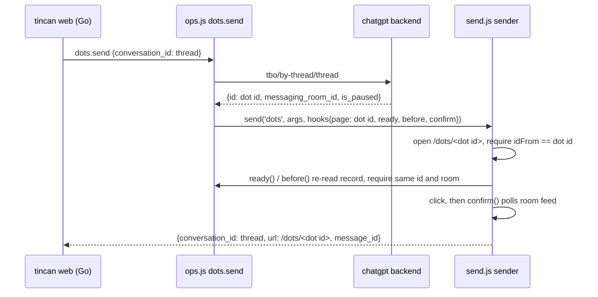

# Dots Send After the /dots/home Redirect - Plan

## Goal Capsule

- Objective: A dot-web agent's replies land in the owner's dot DM again, and never in any other conversation, on the ChatGPT layout where `/dots/<thread>` redirects to `/dots/home`. A new owner can set up dot-web without hunting for a thread id the UI no longer shows.
- Means: open the dot by its dot-id route `/dots/<dot id>` and keep the URL identity check against that id (KTD1, KTD2). Setup discovers the thread from the primary dot record (KTD5).
- Authority: Product Contract requirements win on behavior. KTDs win on mechanism. Live chatgpt.com evidence in the Appendix wins over older code comments.
- Stop conditions: stop and report if the dot-id route also starts redirecting to `/dots/home` for a real dot, if an unknown dot id stops redirecting to `/dots/home`, or if `tbo/by-thread/<thread>` stops returning an `id` that loads the same room. Any one of these invalidates KTD1.
- Execution profile: extension JS (node --test) plus a small Go CLI change. No relay or wire-format change.
- Finishing: ce-work implements and verifies locally. A live send into the owner's real dot needs the owner's OK first because it posts a real message.

---

## Product Contract

### Summary

The dots sender stops opening `/dots/<thread>`, which ChatGPT now redirects to `/dots/home`. It opens `/dots/<dot id>`, a route that still names the dot, and checks the loaded address against that id before typing and before each click. The configured thread stays the agent's identity everywhere else. `tincan web install --site dots` gains a way to fill in the thread from the account's primary dot.

### Problem Frame

Between about 2026-10-03 and 2026-10-10, ChatGPT began redirecting `https://chatgpt.com/dots/<thread>` to `https://chatgpt.com/dots/home` (issue #150). `extension/send.js` reads the conversation id from the loaded URL with `SITES.dots.idFrom`, captures `home`, and throws `not_found: conversation not found`. Every outbound dot reply fails and retries every minute. Reads (`tbo/by-thread`, room feed) still work. A second reporter on v0.16.0 cannot set up dot-web at all, because the UI only ever shows `/dots/home` and there is no visible thread id to pass to `--thread`.

Reproduced 2026-10-13 against the owner's account: `/dots/01a0efac-…` lands on `/dots/home` with the composer present and the thread id nowhere in the DOM. Before redirecting, the page itself requests `backend-api/tbo/<url segment>`, gets 404 for a thread id, and falls back to the primary dot.

### Requirements

Send path

- R1. A dots send opens a page whose address identifies the target dot, and refuses (nothing typed) unless the loaded address names that same dot.
- R2. The identity check runs on load and again right before every click, as it does today for every site.
- R3. `/dots/home` is never accepted as proof of identity, even when the account has a single dot.
- R4. If the dot record no longer names the dot or room it named when the send began, the send fails before the next click.
- R5. The send's result, tab keeping, and close stay keyed on the configured thread, so the Go side, journal, and `dots.close` need no change.

Setup

- R6. `tincan web install --site dots` without `--thread` resolves the thread from the account's primary dot through the connected extension, prints the dot's name and the thread it chose, and installs with it.
- R7. Help and error text stop telling owners to copy the id from `chatgpt.com/dots/<id>`.

### Acceptance Examples

- AE1. Covers R1, R3. Given the dot-id route redirects to `/dots/home`, when a dots send loads the tab, then it fails `not_found`, nothing is typed, and the tab closes.
- AE2. Covers R4. Given the by-thread record returns a different dot id on the pre-click re-read, then the send fails `endpoint_changed` and no click happens.
- AE3. Covers R6. Given no `--thread` and no extension connected, then install fails with a message saying to open Chrome with the extension, or pass `--thread`.

### Scope Boundaries

- Reads (`dots.detail`), the feed confirmation after the click, and every other site are unchanged.
- No support for picking among several dots at send time. The send follows whichever dot the configured thread belongs to, and that can be any dot, not only the primary one.
- Go's `dotsConvPath` (parsing a pasted `/dots/<thread>` URL) is left alone. New-style URLs carry a dot id, not a thread, so they cannot be mapped to a thread offline.

#### Deferred to Follow-Up Work

- A `--dot` flag or picker for owners with more than one dot during setup. Today `tbo?limit=25` lists them, but no reporter needs it yet.

---

## Planning Contract

### Key Technical Decisions

- KTD1. Navigate to the dot-id route. `tbo/by-thread/<thread>` already returns the dot record, and its `id` (shape `<account uuid>~<32 hex>`) is the segment ChatGPT's own router resolves through `tbo/<id>`. Loading `/dots/<id>` was verified live to stay on that address and load the same messaging room as the configured thread. A well-formed but unknown dot id was verified to redirect to `/dots/home` rather than keep the address, so the route resolves the dot it names and fails closed instead of showing the primary dot under another dot's address. This keeps an address-based identity check, which is what issue #150 asked to preserve. A DOM- or primary-dot-based check was rejected because the thread id is absent from the DOM and "primary" says nothing about which dot the owner configured.
- KTD2. The sender takes the page id from the feed hooks. `dotHooks` gains a read-only `page` value (the dot id). For a `confirmByFeed` site, `createSender.send` uses `hooks.page` for `convURL` and for both `idFrom` comparisons, and keeps `existing` (the thread) for `keep`, `close`, and the returned `conversation_id`. The result's `url` becomes the page actually opened. No other site sees a change because only dots supplies `page`.
- KTD3. Validate the dot id strictly before any tab opens. `dotRecord` requires `id` to match a dedicated pattern (two `[A-Za-z0-9_-]` runs joined by one `~`, bounded length) and fails `endpoint_changed` otherwise. `SITES.dots.idFrom` is rewritten to capture exactly that shape, so `home` can never match (R3).
- KTD4. Pin the dot id in the existing re-checks. `dotNotPaused` already re-reads the record before the fill and before each click. It also compares `rec.id` to the id captured at send start (R4).
- KTD5. Setup asks the extension. A new extension op `dots.primary` reads `tbo/primary` and returns `{thread, dot, name}` from `profile.active_root_thread_id`, `profile.id`, and `profile.display_name`. Verified live: `active_root_thread_id` matches Go's thread pattern and resolves through `tbo/by-thread` to the same dot and room. The CLI calls it through the existing native client (`history.NewClient()`, as `web serve` already does for the grant check) only when `--thread` is omitted for `--site dots`.

### High-Level Technical Design

Directional only.

### Assumptions

- The dot-id route is stable enough to ship. It is the form ChatGPT's own sidebar-free navigation resolves, but OpenAI has changed this surface once already. The Stop conditions cover a second change.
- A non-primary dot's id loads that dot's room. This was inferred from the unknown-id redirect, because the only account checked has one dot. If someone with two or more dots can check it, compare the room the page requests with the record's `messaging_room_id`.

---

## Implementation Units

### U1. Dot id in the dot record and hooks

- Goal: `dots.send` knows the dot id, validates it, and re-checks it before typing and clicking.
- Requirements: R4, KTD3, KTD4.
- Dependencies: none.
- Files: `extension/ops.js`, `extension/test/ops.test.js`.
- Approach: add a `DOT_ID_RE` beside `DOT_ROOM_RE`. Check `rec.id` against it on the send path only (`dotRoom` as called by `dots.send`, and the `dotNotPaused` re-reads), and leave `dotRecord`'s shared shape check unchanged so `dots.detail` keeps its current behavior. Have `dotRoom` return the dot id, and pass it into `dotHooks` as `page`. `dotNotPaused` takes the expected dot id and fails `endpoint_changed` ('the dot record names another dot') on a mismatch.
- Test scenarios:
  - by-thread record without `id`, or with `id: "home"` or a value with two `~` → `dots.send` rejects with `endpoint_changed` before any tab opens, and `dots.detail` still succeeds on the same record.
  - `dots.send` hands the sender hooks whose `page` equals the record's `id`.
  - record `id` changes between the first read and `before()` → `endpoint_changed`.
  - existing paused-dot and wrong-room tests still pass with the realistic id.
- Verification: `cd extension && npm test`.

### U2. Sender opens and checks the dot-id route

- Goal: the send loads `/dots/<dot id>`, refuses `/dots/home`, and still reports the thread as its conversation.
- Requirements: R1, R2, R3, R5, KTD1, KTD2, KTD3.
- Dependencies: U1.
- Files: `extension/send.js`, `extension/test/send.test.js`.
- Approach: in `SITES.dots`, rewrite `idFrom` to capture the dot-id shape. In `createSender.send`, when `feed` is true, require `hooks.page` to be a non-empty string (else `internal`), derive `pageId` from it, and use `pageId` for `target`, the post-load check, and the per-click `urlId()` check. Keep `existing` for `keep(tab.id, site, existing)` and the returned `conversation_id`, and set the returned `url` to `cfg.convURL(pageId)`. Update the header comment that says the dot DM lives at `/dots/<thread>`.
- Test scenarios:
  - happy path: created tab URL is `https://chatgpt.com/dots/<dot id>`, message typed and clicked, result `{conversation_id: DOT_THREAD, url: …/dots/<dot id>, message_id}` (update the existing first dots test and `dotFetch`'s `id: 't1'`).
  - AE1: `FakeSite` with `redirectTo: 'https://chatgpt.com/dots/home'` → `not_found`, `submitted` empty, tab closed.
  - page redirects away after load but before the click → `not_found`, no click.
  - `confirmByFeed` hooks without `page` → `internal`, no tab opened.
  - `dots.close` with the thread still closes the kept tab.
  - non-dots sites: existing suite passes unchanged.
- Verification: `cd extension && npm test`.

### U3. Setup discovers the thread

- Goal: an owner who only sees `/dots/home` can install dot-web.
- Requirements: R6, R7, KTD5.
- Dependencies: U1 (it adds `DOT_ID_RE`, which `dots.primary` reuses). U3 can run in parallel with U2 once U1 lands.
- Files: `extension/ops.js` (op, spec, OPS list), `extension/test/ops.test.js`, `internal/history/sites.go` (new op kind), `internal/history/native.go` (op constant and a small result parser), `internal/history/dots.go`, `internal/history/dots_test.go`, `internal/cli/web.go`, plus the CLI test that covers `webThreadFlag` if one exists, else a new case beside the existing `internal/cli` web tests.
- Approach: add a `dots.primary` op with an empty arg spec under the ChatGPT grant, reading `tbo/primary` with `chatgptAuth`. Validate `profile.active_root_thread_id` against the same thread shape Go accepts, and validate `profile.id` with `DOT_ID_RE`. On the Go side, the op model only accepts a fixed set of verbs (`opKind` in `internal/history/sites.go`), so add a `primary` kind that `webSite.hasOp` allows for the dots site only and `ValidateOp` treats as taking no arguments, like `session`. Parse the result and run the thread through `ParseWebThread`. Change `web install` only: when `--site dots` has no `--thread`, call the op with a short timeout and print `using dot "<name>" thread <id>`. Then continue as if `--thread` had been passed, so the service definition keeps an explicit thread. `web serve` keeps requiring `--thread`, which the installed service definition always supplies; launchd often starts it before Chrome is running. If the op fails for any reason (no extension connected, an older host or extension answering `unknown operation`, missing grant, not signed in), install fails with that reason and one hint: update the extension and restart Chrome, or pass `--thread`. Rewrite the `--thread` help and the error strings in both commands to say the id comes from `tincan web install --site dots` discovery or from the dot's backend record, not from the address bar.
- Test scenarios:
  - ops: `dots.primary` maps `{thread, dot, name}`. Missing `profile` or malformed ids → `endpoint_changed`. 401 → `not_logged_in`. Ungranted chatgpt → the same refusal as other dots ops. The OPS list assertion includes `dots.primary`.
  - Go: a valid result parses. An uppercase thread canonicalizes. A thread failing `ParseWebThread` is an error. `dots.primary` validates, and `chatgpt.primary` is rejected as an unknown operation.
  - CLI: an explicit `--thread` never calls the extension. A missing `--thread` with no extension connected yields the AE3 message. A fake channel answering `bad_request` "unknown operation" yields the update-or-pass-`--thread` hint. `web serve` without `--thread` still fails as before.
- Verification: `go test ./internal/history/... ./internal/cli/...` and `cd extension && npm test`.

---

## Verification Contract

| Gate | Command | Proves |
|---|---|---|
| Extension unit tests | `cd extension && npm test` | U1, U2, U3 extension side |
| Go tests | `go test ./...` | U3 Go side, no regressions |
| Go vet | `go vet ./...` | build hygiene |
| Live read-only check | load the unpacked extension, run `dots.primary`, open `/dots/<dot id>` in a background tab and confirm the address stays and the page requests the record's room, then open `/dots/<account uuid>~` plus 32 zeros and confirm it redirects to `/dots/home` | KTD1 and KTD5 still hold on the live site |
| Live send (owner approval required) | with the local dot-web service on the new build, trigger one outbound reply | end to end: lands in the right dot, no `conversation not found` in `~/Library/Logs/tincan-dot-web.log` |

The local dot-web service currently cannot reach its relay at `100.73.62.112:8787` (poll timeouts). That has to be fixed separately before the live send gate can run.

## Definition of Done

- All units' test scenarios exist and pass under the Verification Contract commands.
- No dots code path accepts `/dots/home` as identity.
- Help and error text no longer point owners at `chatgpt.com/dots/<id>`.
- Comments in `extension/send.js` and `extension/ops.js` describe the dot-id route.
- No leftover experimental code or probes in the diff.
- PR body references #150 and notes the live-verified route.

---

## Appendix

Live findings, 2026-10-13, owner's account, read-only:

- `/dots/<thread>` → `/dots/home` about 2s after load. Composer and Send button present. Thread id absent from the DOM and `history.state`.
- Page requests on that load include `tbo/<thread>` → 404, `tbo/primary` → 200, `tbo?limit=25&include_room_preview=false` → 200 (`{items, cursor}`, one item), `tbo/<dot id>/threads?limit=100&include_hidden=true` → 200 (34 threads, including the configured one).
- `tbo/primary` → `{selection: {thread_id, messaging_room_id, available, …}, profile: {id, display_name, messaging_room_id, active_root_thread_id, is_paused, …}}`. The profile `id` equals the by-thread record `id` for the configured thread. Its room equals the configured thread's room. `active_root_thread_id` differs from the configured thread, so threads rotate while dot and room stay fixed.
- `/dots/<dot id>` stays put, shows the composer, and loads room `21f34cab…`, the configured thread's room.
- `/dots/<account uuid>~00000000000000000000000000000000` (well-formed, no such dot) redirects to `/dots/home`.
- Code: `extension/send.js` `SITES.dots` and the `existing` checks in `createSender.send`. `extension/ops.js` `dotRecord`, `dotNotPaused`, `dotRoom`, `dotHooks`, `'dots.send'`. `internal/cli/web.go` `webThreadFlag`. `internal/history/dots.go` `dotsThreadPattern`.
